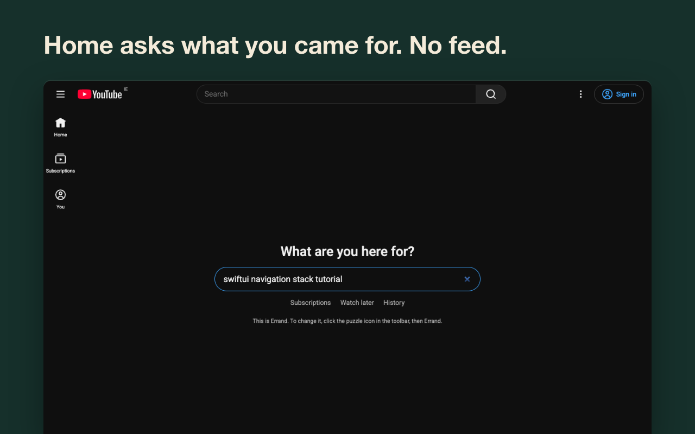

# Errand for YouTube

**Errand for YouTube is a free, open-source Chrome extension that hides YouTube Shorts, the home feed and recommendations, and asks what you came for instead.**

Hide YouTube Shorts, the home feed and recommendations. Say what you came for, watch it, close the tab.

A free, open-source alternative to Unhook, DF Tube and Remove YouTube Suggestions.

[Chrome Web Store](https://github.com/SomeStay07/errand-for-youtube) · [Website](https://somestay07.github.io/errand-for-youtube) · [По-русски](#по-русски)

## What it does

- **Home** shows one question, "What are you here for?", instead of the feed. Or opens Subscriptions, Watch later or the usual feed.
- **Shorts** are hidden on home, search, subscriptions, channel pages and the sidebar. Shorts links open in the normal player, or are blocked.
- **Video page**: no recommendations column. "Show recommendations" reveals it after 10 seconds. Comments are behind a button.
- **End of a video**: no autoplay, no thumbnail wall. Errand asks if you found what you came for and offers to close the tab.
- **Also hidden**: Mixes, Trending, empty-search suggestions. Optional: live chat, notification bell, view, like and subscriber counts, bright thumbnails.
- **Strict mode** on a schedule: no "show" buttons during the hours you pick.
- **Weekly count** of videos opened on purpose vs. drifted into, stored only in your browser.
- **"!" on the icon** when YouTube changes its layout and something Errand hides is back.

## Privacy

No analytics, no account, no network requests. Permissions: `www.youtube.com` (to hide elements) and `storage` (settings). See [PRIVACY.md](PRIVACY.md).

## Install from source

1. `npm run build` creates `dist/chrome` and `dist/errand-chrome-<version>.zip`. Other browsers: `node scripts/build.mjs firefox edge opera`.
2. Chrome: `chrome://extensions` → Developer mode → Load unpacked → `dist/chrome`.

## Development

- `npm test`: logic, i18n key parity and store length limits.
- `node scripts/render.mjs`: icons from `assets/mark.svg`.
- `node scripts/store-images.mjs`: store screenshots and promo tiles from `store/shots/`.
- Languages: `_locales/{en,ru,es,pt_BR,de}`. The extension follows the browser's language.

Something leaked through after a YouTube update? [Open an issue](https://github.com/SomeStay07/errand-for-youtube/issues) with a screenshot.

License: GPL-3.0.

---

## По-русски

Errand прячет Shorts, главную ленту и рекомендации YouTube. Вместо ленты главная спрашивает: «Зачем вы здесь?» В конце видео нет автовоспроизведения, зато есть кнопка «Закрыть вкладку». Рекомендации и комментарии открываются по кнопке, рекомендации — после 10 секунд ожидания.

Бесплатно, код открыт. Без аналитики, аккаунтов и запросов в сеть. Работает в Chrome, а также в Яндекс Браузере, Brave и Vivaldi через Chrome Web Store.

[Установить из Chrome Web Store](https://github.com/SomeStay07/errand-for-youtube)
